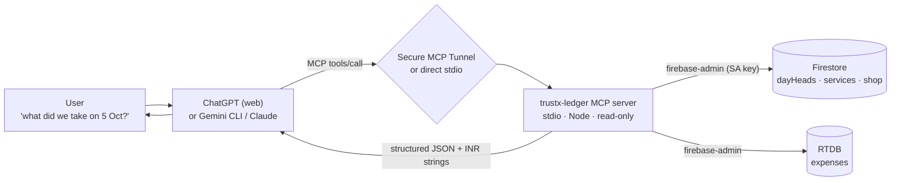

# TrustX Ledger — MCP server (AI-client facing)

> **Status: proposal.** Nothing in this document is built yet. It is the plan
> for an MCP server that lets an AI assistant answer questions about the shop's
> **live data** — today's takings, dues, expenses, month gaps, per-day totals,
> the service catalog. It is written against the code as it is at `v0.13.1`.
>
> **Which assistant?** The server is deliberately client-agnostic. On a **paid**
> ChatGPT workspace the best client is ChatGPT over **Secure MCP Tunnel** (so
> nothing is exposed publicly); Gemini CLI and Claude work locally with no
> account. A **free** ChatGPT or free Gemini account *cannot* connect — custom
> MCP is a paid feature on both. See [§3](#3-which-ai-assistant-can-connect) for
> the comparison, the **free-tier reality** table, and the in-app alternative.

---

## 1. Goal, in one sentence

Expose TrustX Ledger's **read-only** figures to an AI assistant as MCP tools, so a shop
owner or developer can ask *"how much did we take on 5 Oct, and is anything
still due this month?"* and get an answer derived from the **same arithmetic the
app itself uses** — not from a second, drifting implementation.

### What it answers

| Question a user actually asks | Where the answer lives |
|---|---|
| "How did today go?" | `dayHeads/{today}.counters` + expenses |
| "What did we take on 5 Oct?" | `dayHeads/2026-10-05` |
| "Which days this month have nothing on them?" | month read of `dayHeads` |
| "What's still due this month?" | `status == pending` rows in the month's days |
| "What did we spend on electricity?" | RTDB `expenses/{dateKey}` |
| "Is this day's head in step with its sales?" | `js/day-audit.js` recompute |
| "What do we charge for lamination?" | `services/` |
| "Who can open the ledger?" | `accessGrants/` |

## 2. Non-goals for v1

The first version is deliberately narrow. Each of these is a decision, not an
omission:

- **No writes.** Not one tool mutates money. Recording a sale, settling a due,
  adding a service, closing a day — all out of scope. A read-only server that
  holds a service-account key physically cannot move a day's counters, which is
  the single biggest risk reduction in the whole design.
- **No remote hosting.** v1 is a **stdio** process on the operator's own
  machine. No listening port, no network surface.
- **No new data store.** It reads Firestore and RTDB. It has no database of its
  own, and never writes a cache the app can see.
- **No all-time due total.** The owner console already refuses this on purpose
  (see README → *Owner Console*): an all-time figure costs one read per unpaid
  sale and would blow the Spark budget. The MCP server inherits that rule.

## 3. Which AI assistant can connect

**The assistant is the MCP client; the server is a data provider.** The
assistant does the reasoning and the natural-language work; the server only
answers with facts.

Not every "AI app" can host a custom MCP server, and the differences are not
cosmetic. As of **October 2026**:

| Surface | Custom MCP? | Transport it accepts | Must be publicly reachable? | Auth | Plan needed | Mobile |
|---|---|---|---|---|---|---|
| **ChatGPT** | **Yes** | StreamableHTTP **+ a local stdio server via Secure MCP Tunnel** | **No** — the tunnel keeps it private | optional | **Pro** (read/fetch) · **Business/Enterprise/Edu** (full, beta) | **web only** |
| Gemini Enterprise (`business.gemini.google`) | Yes | **StreamableHTTP only** (no SSE) | **Yes** — public HTTPS, publicly-trusted cert | OAuth 2.0 or none | Business/Enterprise | — |
| Gemini CLI / Antigravity CLI | Yes | stdio or HTTP | No | none | free tier moved to Antigravity CLI (Jun 2026) | — |
| Claude Desktop / Claude Code | Yes | stdio or HTTP | No | none | any | — |
| **Consumer Gemini app** (`gemini.google.com`) | **No** | — | — | — | — | — |

Two findings shape the rest of this document (both from Google's and OpenAI's own
docs at the time of writing):

1. **The consumer Gemini app cannot connect to a custom MCP server.** Only
   Gemini *Enterprise* can, and it refuses stdio and self-signed certificates,
   so it would force the shop's money data onto a public HTTPS endpoint with
   OAuth. That is a much heavier and riskier build, so it is not the primary
   target.
2. **ChatGPT *can* reach a local server, privately.** OpenAI's **Secure MCP
   Tunnel** runs a `tunnel-client` inside the shop's own network, connects to
   the MCP server over **stdio**, and dials **outbound** to OpenAI — so the data
   never sits behind a public listener. And for a **read-only** server, the
   **Pro** plan's read/fetch developer mode is sufficient, which matches this
   project's v1 exactly.

So, **when there is a paid ChatGPT workspace**, the best client is ChatGPT over
Secure MCP Tunnel, with the local **stdio** server the rest of this plan
describes. Gemini CLI and Claude point at the same stdio process with no changes.

### Free-tier reality

A **free ChatGPT** or **free consumer Gemini** account **cannot use this server at
all**, because custom MCP is a paid feature on both: ChatGPT needs Pro
(read-only) or Business/Enterprise, and the consumer Gemini app has no MCP
support at any tier. That is a limit of the *client*, not the server — the stdio
server is unchanged. A free account therefore means picking a different client:

| Free client | Type | MCP | Notes |
|---|---|---|---|
| **Claude Desktop** (free) | GUI | local stdio | simplest GUI path; free tier has usage limits |
| **Antigravity CLI** (free tier, no card) | terminal | yes | Google's Gemini-CLI successor since Jun 2026 |
| **LibreChat / Jan / Cherry Studio / Msty** | GUI | yes | open-source; pair with a **free Google AI Studio key** |

If the goal is to ask questions from a **phone**, none of the above fits well —
they are desktop and terminal tools. The one phone-friendly, no-subscription
option is to **skip MCP entirely** and put the question box inside the ledger
itself, calling the free Gemini API (the key is already scaffolded in
`js/ai-config.js`). See [§15](#15-alternative-ask-the-ledger-inside-the-app).



This shape keeps the **blast radius** small. The server never needs an LLM API
key, never makes an outbound model call, and never decides what is safe to say —
it returns the same numbers the app shows, and the assistant phrases them.

> A second design — the server itself calling
> `generativelanguage.googleapis.com` and exposing one `ask_ledger` tool — was
> considered and rejected for v1: it puts an LLM API key inside the process that
> holds a database master key, and it duplicates reasoning the client already
> does. It can be added later as an *additional* tool without changing anything
> below. The same reasoning applies to a self-built Gemini-API chatbot.

## 4. Where the code lives, and the zero-dependency tension

The app's proudest constraint is in `package.json`: **zero runtime
dependencies, no build step**. An MCP server needs the MCP SDK, and firebase-admin
pulls a dependency tree. Those two facts cannot both be true of the same
`package.json`.

The resolution is **isolation**:

```text
leadger/
├─ package.json            # the app — stays at zero dependencies
├─ js/                      # the app's pure modules, REUSED by the server
├─ tools/                   # existing dev scripts
└─ mcp/                     # NEW — a separate Node package
   ├─ package.json          # @modelcontextprotocol/sdk, firebase-admin
   ├─ server.js             # stdio entry point, registers tools
   ├─ config.js             # project id, SA key path, budgets, redaction flags
   ├─ lib/
   │   ├─ tools.js          # PURE handlers — no firebase-admin import
   │   ├─ format.js         # paise → INR, date labels (thin wrapper on js/utils.js)
   │   ├─ firestore-repo.js # imports firebase-admin, implements the repo
   │   └─ rtdb-repo.js
   ├─ README.md
   └─ .env.example
```

Three consequences, all wanted:

1. `npm install` is run **inside `mcp/` only**. The app is untouched.
2. `firebase.json` hosting must add **`mcp/**`** to its `ignore` list so the
   server source and `node_modules` are never deployed to the public site.
3. `.gitignore` already ignores `node_modules/` and the service-account
   patterns (`sa.json`, `service-account.json`, `*-service-account.json`), so
   the key stays out of git for free. Add `mcp/.env` to be explicit.

### Reuse, don't re-derive

The app's pure modules import nothing from Firebase or the DOM, which is
exactly what lets `tests/ledger.mjs` run them in bare Node. The server does the
same thing:

```js
// mcp/lib/format.js — the same functions the pages use
import { todayKolkata, formatINR, isValidDateKey } from "../../js/utils.js";
import { auditDayCounters, describeAudit } from "../../js/day-audit.js";
import { emptyCounters, splitAmounts } from "../../js/day-heads.js";
```

So the paise arithmetic, the `Asia/Kolkata` date key, the counter invariant and
the day-integrity verdict are **the same code** the browser runs. A regression
in `js/day-heads.js` breaks the MCP server and the app together, which is the
whole point of the project's testing philosophy.

## 5. Data access and least privilege

Reads use `firebase-admin` with a service-account key, which **bypasses
`firestore.rules` and `database.rules.json` entirely**. That is precisely why
the key is dangerous and why v1 has no write tools.

**Do not use the default `firebase-adminsdk-*` key.** Create a dedicated
service account and grant only:

| Role | Needed for |
|---|---|
| `roles/datastore.viewer` | Firestore reads (`dayHeads`, `services`, `shop`, `accessGrants`) |
| `roles/firebasedatabase.viewer` | RTDB reads (`expenses`) |

No Editor, no Owner. A read-only server *plus* a read-only identity is belt and
braces: even a bug in the code cannot write.

Configuration (never committed):

```bash
# mcp/.env  (gitignored)
GOOGLE_APPLICATION_CREDENTIALS=C:\Users\PRAKAS\secrets\trustx-mcp-reader.json
FIREBASE_PROJECT_ID=trustxplpy
```

For dry development, point at the emulators the same way
`tools/bootstrap-access.mjs` does (`FIRESTORE_EMULATOR_HOST`,
`FIREBASE_DATABASE_EMULATOR_HOST`) — the emulator accepts `Bearer owner` and
needs no key at all.

> **Alternative considered:** the repo currently avoids `firebase-admin` in
> `tools/bootstrap-access.mjs` by signing a JWT with `node:crypto` and calling
> the Firestore REST API directly — zero dependencies. The MCP server could do
> the same for Firestore. It was **not** chosen because the MCP SDK is already a
> dependency, so the zero-dep purity is already spent, and the Admin SDK also
> covers RTDB and handles token refresh. This is recorded so the choice is
> visible, not accidental.

## 6. The constraint everyone forgets: reads cost money

The shop runs on **Spark** (`js/quota.js`): **50,000 Firestore reads, 20,000
writes, 20,000 deletes per day**, then everything fails with
`RESOURCE_EXHAUSTED` until a Pacific-midnight reset (mid-afternoon in India). An
MCP server that scans sales is not free — it **shares that same budget with the
counter** and can brick a live shop's day.

So the server obeys the same discipline the app does:

- **Prefer day heads to sales.** One `dayHeads` document per business day is one
  read. A month is ~30 reads folded off heads, never a read per sale.
- **Never scan all history to answer a "this month" question.**
- **Cap every list.** `ledger_transactions` pages; `ledger_search` requires a
  date range.
- **Meter itself.** Every tool returns a `_reads` estimate in its payload, and
  `config.js` carries a `--read-budget` guard that refuses a call that would
  exceed the remaining estimate for the day. The app's own meter is per-browser;
  the server's is a second, independent estimate because the assistant is a second
  consumer.
- **Short-lived head cache.** A 60-second in-process cache of `dayHeads` reads
  (mirroring `js/read-cache.js`'s stale-while-revalidate idea) so "today's
  summary" asked three times costs one read.

## 7. Correctness rules the server must honour

These are the app's own invariants. The server quotes them; it does not
reinterpret them.

1. **Money is integer paise.** Every money field is returned as
   `...Paise` (integer) **and** a formatted `...` string (`"₹1,234.50"`) via
   `formatINR`, so the model never does float arithmetic on rupees.
2. **A business day is `Asia/Kolkata`**, keyed `YYYY-MM-DD`, computed with
   `todayKolkata()` — not the host machine's clock.
3. **"Nothing entered" ≠ `₹0`.** A day with no head is reported as
   `recorded: false`, never as a zero total. The difference is the whole point of
   the calendar view.
4. **Day heads can drift, and the server says so.** `firestore.rules` cannot
   re-sum a subcollection, so a head can disagree with its sales. Any day-level
   answer therefore carries an `integrity` block computed by
   `auditDayCounters()` (`ok` · `no-head` · `bad-head` · `unreadable` ·
   `incomplete` · `drifted`), and the **recomputed-from-rows** totals alongside
   the stored counters. A figure the server cannot vouch for is labelled, not
   printed clean.
5. **Closed days are read-only in the app** but still readable, including
   receipt photos. The server mirrors that: `state`, `closedAt`, `closedBy` are
   surfaced, and no edit is offered.
6. **Unread expenses are not zero.** If the RTDB read fails, the server returns
   `expenses: null` + a reason, exactly as `fetchTodaySummary()` does, rather
   than reporting `0` and inflating the net.

## 8. Tool catalog (v1, read-only)

Tools are prefixed `ledger_`. Clients namespace them — Gemini as
`mcp_trustx-ledger_ledger_day` etc. (hence the server name uses a hyphen, not an
underscore — see §10).

### Catalog & identity

| Tool | Inputs | Source | Reads |
|---|---|---|---|
| `ledger_server_info` | — | static | 0 |
| `ledger_shop_info` | — | `shop/general` | 1 |
| `ledger_list_services` | `includeInactive?` | `services/` | 1 query |

### Days

| Tool | Inputs | Source | Reads |
|---|---|---|---|
| `ledger_day` | `dateKey` | `dayHeads/{dateKey}` + its `transactions` | 1 + N |
| `ledger_days` | `from`, `to` | range over `dayHeads` | 1 query |
| `ledger_month` | `yearMonth` | range over `dayHeads` for that month | 1 query |

`ledger_day` returns:

```jsonc
{
  "dateKey": "2026-10-05",
  "recorded": true,
  "state": "closed",
  "closedAt": "2026-10-05T13:40:00Z",
  "counters": {
    "txnCount": 27,
    "grossPaise": 486000, "gross": "₹4,860.00",
    "cashPaise": 200000, "cash": "₹2,000.00",
    "upiPaise": 186000,  "upi": "₹1,860.00",
    "cardPaise": 0,      "card": "₹0.00",
    "duePaise": 100000,  "due": "₹1,000.00",
    "collectedPaise": 386000, "collected": "₹3,860.00"
  },
  "recomputed": { "txnCount": 27, "grossPaise": 486000, "gross": "₹4,860.00" },
  "integrity": { "status": "ok", "summary": "Head matches the day's sales exactly." }
}
```

`ledger_month` returns per-day rows (`recorded`, `gross`, `count`, `state`) plus
`totals` and the list of **days with nothing on them** — the same four statuses
the calendar draws.

### Sales

| Tool | Inputs | Source | Notes |
|---|---|---|---|
| `ledger_transactions` | `dateKey`, `paymentMethod?`, `status?`, `search?`, `limit?`, `cursor?` | day's `transactions` | paged; recomputes nothing |
| `ledger_dues` | `from`, `to` | `status == pending` in range | month-bounded on purpose |
| `ledger_search` | `query`, `from`, `to` | `transactions` in range | **requires** a range; prefix match then in-memory filter |

> **Firestore reality check.** Substring search is not a thing Firestore does;
> `ledger_search` does a prefix query (`>= q`, `< q + \u{f8ff}`) on
> `serviceName` / `customerName` within a date range, then filters in the
> server. A collection-group query over all `transactions` would need a new
> collection-group index in `firestore.indexes.json` (currently empty), so the
> server iterates day heads instead — more reads, but no new index and no change
> to the deployed app. This trade-off is the one to revisit if search becomes
> hot usage.

### Expenses, integrity, receipts, access

| Tool | Inputs | Source | Notes |
|---|---|---|---|
| `ledger_expenses` | `yearMonth` or `dateKey` | RTDB `expenses/` | `null` + reason when unreadable |
| `ledger_day_integrity` | `dateKey`, `includePlan?` | head + rows | `auditDayCounters` + `describeAudit` (+ `planDayRepair`, **plan only — never applied**) |
| `ledger_receipt` | `txnId`, `dateKey`, `includeImage?` | `receiptImages/{txnId}` | returns `bytes`, `capturedAt`; base64 image only on request |
| `ledger_access_list` | — | `accessGrants/` (+ `allowedUsers/`) | **sensitive — see §11** |

### Response shape (all tools)

```jsonc
{ "data": { /* tool-specific */ }, "_reads": 3, "_warnings": [] }
```

`_reads` is the server's read estimate for the call; `_warnings` carries
human-readable cautions (`"expenses could not be read; net withheld"`). Both are
for the model to reason with, and for the operator to audit cost.

## 9. Resources & prompts

Tools answer questions; **resources** give the assistant stable context so it
interprets the tools correctly.

| Resource URI | Content | Why |
|---|---|---|
| `ledger://schema` | data model, units, day semantics, closed-day rules | so the model knows paise ≠ rupees and "nothing entered" ≠ ₹0 |
| `ledger://glossary` | the shop's terminology (backfilled, due, closed) | fewer clarifying questions |
| `ledger://today` | today's summary | a one-`@`-reference shortcut |

Prompt: `daily_close_summary(dateKey)` — "Summarise {dateKey}: takings by method,
dues, expenses, net, and whether the head is in step." Server-side prompt, no
extra reads beyond the tools it names.

## 10. Wiring a client to the server

The server is one local stdio process. **ChatGPT reaches it through Secure MCP
Tunnel** (primary); **Gemini CLI and Claude point at it directly** (secondary).

### 10.1 ChatGPT (primary — keeps the data private)

ChatGPT never talks to `localhost`. Instead `tunnel-client` runs inside the
shop's network, reaches the MCP server over stdio, and dials **outbound** to
OpenAI:

```bash
# One-time: needs a tunnel_id from
#   https://platform.openai.com/settings/organization/tunnels
# and a runtime API key. Requires Tunnels Read + Use permission.
tunnel-client init \
  --sample sample_mcp_stdio_local \
  --profile trustx-ledger \
  --tunnel-id tunnel_0123456789abcdef0123456789abcdef \
  --mcp-command "node C:/Users/PRAKAS/Desktop/leadger/mcp/server.js"

tunnel-client doctor --profile trustx-ledger --explain
tunnel-client run    --profile trustx-ledger
```

Then in ChatGPT: **Plugins → plus → Add custom MCP server → Connection:
Tunnel → select `trustx-ledger`** → review the risk warning → **Create as a
plugin**. Keep `tunnel-client run` alive while you create and test the app.

Requirements and caveats, from OpenAI's docs:

- **Plan:** read/fetch MCP in developer mode works on **Pro**; full MCP
  (including writes) is beta on **Business / Enterprise / Edu**. This server is
  read-only, so Pro is enough.
- **Web only.** ChatGPT apps are not available on mobile.
- **Admin permissions:** a workspace admin enables developer mode; tunnel
  creation needs Platform-org Tunnels **Read + Manage**, running the client
  needs **Read + Use**.
- **Tool changes are frozen on approval.** After the app is created, ChatGPT
  snapshots the tool list; changes need a manual refresh. Keep names and schemas
  backward-compatible (see §12).
- Secure MCP Tunnel is **not** valid for public plugin *submission* — that needs
  a stable public HTTPS endpoint. We are not submitting publicly.

### 10.2 Gemini CLI and Claude (secondary — direct stdio)

Both read `mcpServers` from a config file; on Windows point `command` at `node`
and `cwd` at `mcp/`:

```jsonc
{
  "mcpServers": {
    "trustx-ledger": {
      "command": "node",
      "args": ["C:/Users/PRAKAS/Desktop/leadger/mcp/server.js"],
      "cwd": "C:/Users/PRAKAS/Desktop/leadger/mcp",
      "env": {
        "GOOGLE_APPLICATION_CREDENTIALS": "$LEDGER_MCP_SA_KEY",
        "FIREBASE_PROJECT_ID": "trustxplpy"
      },
      "timeout": 30000,
      "trust": false
    }
  }
}
```

- **`trust: false`** keeps a confirmation prompt on every tool call. Flip to
  `true` only once the tool list is frozen and read-only, or use
  `includeTools` to allowlist the safe subset.
- **`env` values use `$VAR`** so the key path lives in the environment, not in
  the config file. Gemini CLI explicitly **does not** inherit `*KEY*`/`*SECRET*`
  variables into spawned servers unless declared here — the `env` block *is* the
  consent.
- Alternatively: `gemini mcp add trustx-ledger node C:/.../mcp/server.js`.
- **Server name uses a hyphen.** Gemini CLI splits tool FQNs on the first `_`, so
  a name with an underscore would break wildcard policy rules silently.

Development loop: run the server alone first (`node mcp/server.js` speaks
JSON-RPC on stdio), then `gemini mcp list` / `/mcp`, or `npx
@modelcontextprotocol/inspector` against a temporary HTTP wrapper while building
tool schemas.

## 11. Security & threat model

| Asset | Risk | Mitigation |
|---|---|---|
| Service-account key | Full read/write on both databases | Dedicated SA; **read-only IAM roles**; key outside the repo; `GOOGLE_APPLICATION_CREDENTIALS`, not a committed file |
| Money integrity | Server writes a wrong counter | **No write tools in v1** — by construction |
| Spark quota | A query loop exhausts the day and blocks the shop | Read estimate per call + `--read-budget` guard + head caching + hard caps |
| Customer PII (names, receipt photos) | Leaks into a model or a log | `--redact-customers`; receipts returned only when explicitly requested; **logs never print payloads** |
| Access list | Reveals who works at the shop | `ledger_access_list` gated behind a config flag, off by default |
| Prompt injection | Receipt text / a crafted customer name tries to steer the model | Server is read-only; tool output is data, never instructions; the model's own confirmations still apply |
| Network exposure | Remote attacker reaches the data | stdio only, no listening port; ChatGPT uses the outbound-only Secure MCP Tunnel, so there is still no public listener. A future HTTP mode must bind localhost and require a token |

The guiding sentence: **the server is a mirror of `firestore.rules`, not a
second door.** Where the app refuses to answer (all-time dues, an unread
expense, a drifted head printed as clean), the server refuses too.

## 12. Testing

The repo's rule is that logic worth trusting is pure enough to test in bare
Node. The server keeps it:

- `mcp/lib/tools.js` holds **pure handlers** — `(repo, args) => result`. No
  `firebase-admin` import, no I/O.
- `mcp/lib/firestore-repo.js` / `rtdb-repo.js` hold the thin adapter that talks
  to Firebase.
- `tests/mcp.mjs` imports **only** `tools.js` and feeds it a fake in-memory
  repo. Because it never imports `firebase-admin`, `node --test tests/mcp.mjs`
  passes with **no `npm install` at the repo root** — the app's "tests need
  nothing" promise survives.

Cases to cover: paise formatting and the `recorded: false` day; a drifted head
reported as `drifted` with both totals; an unread expense yielding `net: null`;
`ledger_search` refusing without a date range; the read-budget guard refusing an
over-budget call; the redaction flag stripping customer names.

Optionally add a rules-parity check later: `ledger_day_integrity`'s verdict must
agree with `tests/ledger.mjs`'s fixtures, so the two never drift.

## 13. Build order

| Milestone | Deliverable | Done when |
|---|---|---|
| **M0 — skeleton** | `mcp/` package, config, stdio server, `ledger_server_info` + `ping` | `gemini mcp list` shows it CONNECTED |
| **M1 — core reads** | `ledger_shop_info`, `ledger_list_services`, `ledger_day`, `ledger_days`, `ledger_month` | today + a past day + a month answer correctly against real data |
| **M2 — sales & money** | `ledger_transactions`, `ledger_dues`, `ledger_expenses`, `ledger_day_integrity` | a month's dues and expenses reconcile with the app |
| **M3 — reuse + tests** | `tools.js` pure, `tests/mcp.mjs`, root `npm test` picks it up | `npm test` passes with no install |
| **M4 — first client** | connect a **free** client (Claude Desktop or Antigravity CLI), `ledger://schema`, `daily_close_summary` | a real session answers the three headline questions |
| **M5 — hardening** | least-privilege SA, `--read-budget`, redaction, stderr-only logging, `mcp/README.md` | an audit of one day's calls shows zero writes and a sane read count |
| **M6 — optional** | `ledger_receipt` image content, an `ask_ledger` Gemini-backed tool | only if a real need appears |

## 14. Open questions for you

1. **Whose data?** Production `trustxplpy`, or a copy/emulator first? (M0–M2 can
   be built entirely against the emulator.)
2. **Receipt images:** should the assistant ever *see* a photo (via the MCP image
   content type), or is metadata-only enough? Seeing them exposes customer slips
   to the model.
3. **Customer names:** return them, or redact by default?
4. **Access list:** expose `ledger_access_list` at all, or keep it console-only?
5. **Client, given free accounts.** Claude Desktop (free, GUI), Antigravity CLI
   (free, terminal), or an open-source GUI + a free Google AI Studio key
   (LibreChat / Jan / Cherry Studio)? Or drop MCP and build the box into the app
   ([§15](#15-alternative-ask-the-ledger-inside-the-app))?
6. **Phone?** If the shop must ask questions from a phone, §15 is the only
   free, no-subscription path.
7. **Read budget:** what daily read ceiling should the server refuse past — a
   fixed number, or a fraction of the Spark 50,000 shared with the shop?

Once these are answered, M0 is a small, self-contained first commit.

---

## 15. Alternative — "Ask the ledger" inside the app

If the goal is simply *to ask the shop questions and get answers*, and the
constraints are **free** and **phone-friendly**, then MCP may be the wrong tool.
The app already holds a **free Gemini API key slot** in `js/ai-config.js` (used
for receipt OCR), and the shop is already signed in to it. Adding a small
**"Ask" box** to `dashboard.html` would:

- call `generativelanguage.googleapis.com` with **function calling** over the
  same read functions the pages already use,
- reuse the **same pure modules** (`js/day-heads.js`, `js/day-audit.js`,
  `js/utils.js`) as single source of truth,
- run entirely inside the app's existing access chain — no service account, no
  tunnel, no second trusted surface, no public endpoint,
- work on a **phone browser**, because it is just the app.

Trade-offs versus the MCP server:

| | MCP server (§1–14) | In-app "Ask" (§15) |
|---|---|---|
| Client | Claude Desktop / Antigravity CLI / paid ChatGPT | the ledger itself |
| Phone | no (desktop/terminal clients) | **yes** |
| Free | free clients exist | **free Gemini key** |
| Data leaves device | yes, to the model | yes, to the model |
| New auth surface | a service account | none — reuses the grant |
| Works offline | no | same as the app |

It is a genuinely different product (a button in the shop vs. a tool for a
developer), and it is worth deciding between them before writing code, because
they share the read layer but diverge everywhere after it.
